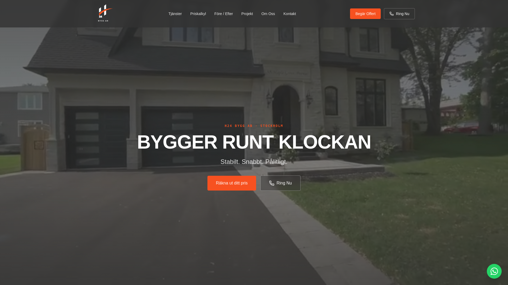

# H24 Bygg AB – Company Website

A fast, brand-driven website for H24 Bygg AB, a Stockholm construction and renovation company, with an online price calculator and a built-in content admin.

**Live:** https://h24byggab.se



## About the project

H24 Bygg AB is a Swedish construction and renovation company based in the Stockholm area. The company needed an information website that presents its services, shows previous work and makes it easy for homeowners to get a price indication and request a quote.

The site was built from the company's brand kit (charcoal / concrete / construction orange, Montserrat + Barlow + Space Mono). It includes an interactive price calculator for carpentry, painting and flooring, an "About" section presenting the founder and the company's values, and clear calls to action for phone, WhatsApp and quote requests.

**My role (Anas Alnaasan, via MIZA Group):** logo design, brand kit, UI/UX design and website development.

## Features

- **Landing page** (`/`) – video hero, services grid, before/after slider, "why choose us", founder/about section, CTA banner and footer.
- **Price calculator** (`/priskalkyl`) – choose service (carpentry, painting, flooring), number of hours and complexity (simple / normal / advanced multiplier) to get an instant estimate, with an optional ROT tax deduction (30 % of labour cost, capped at 50 000 SEK).
- **Projects page** (`/projekt`) – featured projects with before/after photos and autoplaying videos, plus a gallery of earlier work.
- **Contact page** (`/kontakt`) – quote request form, phone, e-mail, address and an embedded Google Map.
- **Interactive before/after comparison** – draggable slider supporting both mouse and touch.
- **Floating WhatsApp button** and click-to-call buttons throughout the site.
- **Content admin** (`/admin`, `/admin/login`) – password-protected dashboard where the client can edit texts, logo, hero video, images and contact details without touching code. Media uploads go to a private Supabase Storage bucket.
- **CMS-style content layer** – every text on the site reads from a single JSON document in the `site_content` table with sensible hard-coded fallbacks, so the site renders even with an empty database.
- **Role-based access** – `user_roles` table plus a `has_role()` SQL function; Row Level Security ensures only admins can update content or upload media.
- **SEO** – per-route titles, meta descriptions and Open Graph tags, a dynamic `/sitemap.xml` route and `robots.txt`.
- **SSR error handling** – custom server entry and middleware that render a friendly error page instead of a raw 500.
- Fully responsive layout with a mobile menu.

## Tech stack

- **Framework:** React 19, TanStack Start (SSR) and TanStack Router (file-based routing)
- **Build:** Vite 7, TypeScript
- **Styling:** Tailwind CSS v4, shadcn/ui (Radix UI primitives), tw-animate-css, lucide-react icons
- **Data / Auth / Storage:** Supabase (PostgreSQL, Auth, Storage, Row Level Security)
- **State / Data fetching:** TanStack Query
- **Validation:** Zod
- **Tooling:** ESLint, Prettier

## Project structure

```
h24-bygg/
├── public/                  # robots.txt (favicon not included)
├── src/
│   ├── components/
│   │   ├── landing/         # Navbar, Hero, Services, BeforeAfter, PriceCalculator, Projects, About, Contact, Footer ...
│   │   └── ui/              # shadcn/ui components
│   ├── hooks/               # use-mobile
│   ├── integrations/supabase/  # Supabase client, server client, auth middleware, generated types
│   ├── lib/                 # site-content provider, admin field config, upload helpers, error handling
│   ├── routes/              # index, priskalkyl, projekt, kontakt, admin, admin/login, sitemap.xml
│   ├── server.ts            # SSR server entry with error wrapper
│   ├── start.ts             # TanStack Start middleware setup
│   └── styles.css           # Tailwind theme + brand tokens
├── supabase/
│   ├── config.toml
│   └── migrations/          # roles, site_content table, RLS and storage policies
└── docs/screenshot.png
```

## Getting started

```bash
npm install
cp .env.example .env    # then fill in your own Supabase project values
npm run dev
```

To use the admin panel, apply the migrations in `supabase/migrations/` to your Supabase project, create a private storage bucket named `site-media`, create a user in Supabase Auth and add a row for that user with role `admin` in `public.user_roles`.

### Assets

Images, videos, logos and the favicon are **not** included in this repository (they belong to the client). The code imports them from `src/assets/` – either as local files (`hero.jpg`, `before.jpg`, `after.jpg`, `logo-color.png`, `logo-white.png`, `project-*.jpg`, `team.jpg`) or as Lovable asset descriptors (`*.asset.json`, e.g. `owner.png.asset.json`, `logo-h24-white.png.asset.json`, `before11.jpg.asset.json`, `after11.jpg.asset.json` and the files under `src/assets/work/` for project photos and videos). To run the project locally, add your own files at those paths (an `*.asset.json` file is a small JSON object with a `url` field pointing to the media file).

## Built with AI-assisted development

This project was built by Anas Alnaasan using Lovable and Claude as AI coding assistants. The brand, design direction, prompting, code review, content structure and deployment were done by me; the AI tools were used to speed up implementation.

## Author

**Anas Alnaasan** · MIZA Group · https://mizagroup.se · https://github.com/anasnassan92-cmyk

---

Source shared for portfolio purposes. © H24 Bygg AB — all brand assets belong to their owner.
